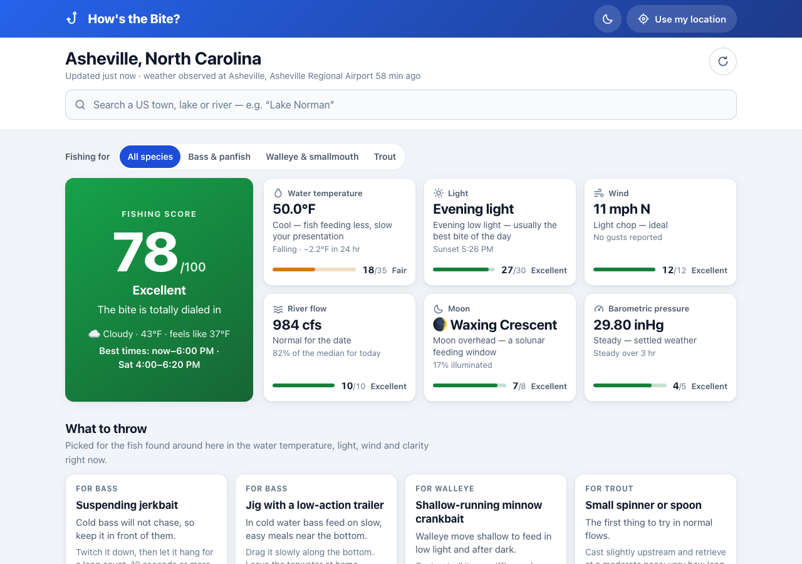

# 🎣 How's the Bite?

A Progressive Web App that answers one question for anglers: **how good is the fishing right now?**
Pick any US town, lake, river, bay or beach and get a 0–100 score built from real water
temperature, the time of day, live weather, river flow compared with normal and the moon, or, in
salt water, the tide and the surf. It comes with lure suggestions for the conditions and the
current river level, lake elevation or tide table. The weights follow what studies of angler
catch rates have actually measured (see [How the score works](#how-the-score-works)).

No framework and nothing to compile: plain HTML, CSS and ES modules. The app itself needs
**no API keys**.



## Features

- **Fishing score (0–100)** with a per-factor breakdown that shows exactly where the points came from,
  tuned to what you are fishing for: all species, bass and panfish, catfish, walleye and pike, or trout
- **Only the fish that live there are offered**: the choices come from occurrence records for the
  region, so there is no walleye option in south Florida and no bass option in Alaska
- **Salt water too**: near the coast, switch between Freshwater, Inshore (bays, flats, marsh,
  piers) and Surf. Salt-water scores use NOAA tide predictions and coastal water temperature, and
  for surf the Weather Service's surf height and rip-current risk
- **What to throw**: three or four lure and bait suggestions for the local fish, each with a link
  to search for it on Amazon. They follow where the fish are in their year (pre-spawn, spawn, the
  fall feed, the bull-red run…), judged from the date, the water temperature and the last month of
  readings; what has changed lately (a cold snap, a front, a lake rising into new cover); and the
  light, wind, clarity and tide right now
- **Solunar major periods** in fresh water: the Moon tile gives the next time the moon is overhead
  or underfoot
- **A score for the day**, not just the moment: the score card leads with each day's best two
  hours, keeps the score right now beside it, and has a strip of the day under the stamp: drag
  along it for the score hour by hour, or pick dawn, morning, afternoon, dusk or night
- **Weather alerts** from the National Weather Service; thunderstorm and other dangerous-weather
  warnings cap the score while they are in effect
- **Live water temperature** from nearby USGS monitoring stations; pick a different station from the
  list or the map, or filter to lakes or rivers. When no sensor is nearby the app falls back to a
  clearly labelled estimate
- **Water level and flow** from the nearest USGS gauge: river gage height and discharge (with the
  median for today's date), or lake and reservoir surface elevation, with the 24-hour change, and
  dissolved oxygen and turbidity where the station measures them
- **Current conditions** observed at the nearest weather station: air temperature, pressure with
  its 3-hour trend, wind and gusts, sky
- **5-day forecast** with highs/lows, precipitation chance and wind
- **Weather on the way**: a cold or warm front in the hour-by-hour forecast, and the next spell of
  rain or thunderstorms, are named above the forecast with when they are due. A front counts in
  the score for the hours either side of it, as far as the evidence supports (not far: see
  [Fronts and weather on the way](#fronts-and-weather-on-the-way))
- **48-hour charts** for pressure, air temperature, water temperature and water level, with
  hover/touch/keyboard read-outs and a data table for each
- **Place search** for towns ("Asheville, NC") and for lakes, reservoirs and rivers by name
  ("Lake Norman", "French Broad River"), recent places, and optional "use my location". A town
  offers the water around it as **Nearby water**, in three kinds that each keep their own
  places: the best-known lakes and reservoirs (a bundled list from Wikidata, rebuilt with
  `node scripts/update-lakes.mjs`), the biggest gauged rivers, and on the coast the bays and
  sounds named by NOAA tide stations. One tap gives the score and gauges for that water
  instead of the town, in inshore mode for salt water
- **A link for every place**: each place has its own address
  (`/fishing/35.6,-82.55/asheville-north-carolina`) that can be bookmarked, reloaded or shared,
  with the kind of water and the fish carried along so a friend sees the same score. **Share**
  opens the phone's share sheet, or copies the link on a computer. Back and Forward move between
  the places you have looked at
- **Installable and offline-capable**: the app shell is cached by a service worker and the last
  loaded conditions are shown (with their real timestamp) when you have no signal
- Light and dark themes, responsive from phone to desktop, keyboard and screen-reader friendly

## Run it locally

```bash
npm install
npm start           # static server at http://localhost:8000 (scripts/serve.mjs, no dependencies)
```

Any static server will show the home page (`python3 -m http.server 8000`, VS Code Live Server, …),
but only `npm start` and `npm run preview` also serve place addresses (`/fishing/…`), so reloading
one elsewhere gives a 404. The page has to be served over `http://localhost` or HTTPS; opening
`index.html` from disk will not work because browsers block ES modules and service workers on
`file://`.

To run it the way it runs in production, with the security headers and the USGS proxy:

```bash
npm run preview     # builds dist/ and serves it with Cloudflare's local runtime at http://localhost:8788
```

The proxy reads its USGS key from a git-ignored `.dev.vars` file in the project root:

```
USGS_API_KEY=your-key-here
```

Without that file the preview still works; the proxy just calls USGS anonymously.

## Tests

```bash
npm test            # unit tests: scoring, tides and salt water, lures, regional species, sun and moon, alerts, the proxies
npm run test:e2e    # browser tests (Playwright): the whole app, desktop and phone layouts
npm run test:all    # both
```

The browser tests need a browser once: `npx playwright install chromium`, or reuse one you already
have with `PLAYWRIGHT_CHANNEL=chrome npm run test:e2e`.

They never call the real services. Every external request is answered from fixtures in
`e2e/support/api-mocks.js` and the clock is pinned, so runs are repeatable, fast (about 15 seconds)
and spend none of the USGS rate limit. A test fails if the page makes a request that has no mock,
throws an uncaught error, or violates the Content-Security-Policy.

To run the same tests against the production-style preview (this is what checks the policy in
`_headers`): start `npm run preview`, then `E2E_BASE_URL=http://localhost:8788 npm run test:e2e`.

## Deploying to Cloudflare Pages

The site is static files plus one small server function, which fits Cloudflare Pages' free plan.
`wrangler.toml` holds the configuration, `npm run build` assembles `dist/`, and anything under
`functions/` is deployed as a Pages Function automatically.

One-time setup:

1. **Log in**: `npx wrangler login` (opens a browser).
2. **Create the project and publish**: `npm run deploy`. The first run offers to create a Pages
   project named `howsthebite` (change `name` in `wrangler.toml` if you prefer another); accept the
   default production branch. You get a `https://<project>.pages.dev` address.
3. **Give the proxy its key**: `npx wrangler pages secret put USGS_API_KEY`, paste the key
   (free at <https://api.waterdata.usgs.gov/signup>), then run `npm run deploy` once more so the
   function picks it up.
4. **Custom domain** (optional): Cloudflare dashboard → Workers & Pages → your project → Custom
   domains → add the domain. If the domain is registered or hosted at Cloudflare the DNS record is
   created for you.

After that, `npm run deploy` publishes a new version.

### Automatic deploys (GitHub Actions)

`.github/workflows/deploy.yml` runs the unit and browser tests on every pull request and every
push to `main`, and deploys only when they pass:

- **Pull requests** deploy a preview to `https://pr-<number>.howsthebite.pages.dev` (and a
  per-commit `https://<hash>.howsthebite.pages.dev`). Previews never touch `howsthebite.io`. The
  link is posted as a comment on the PR (one comment, edited on each push), and also appears as
  **View deployment** and in the run summary. Each new push to the PR updates the same address.
  Pull requests from forks are tested but not deployed, because GitHub does not give them the
  secrets.
- **Merging or closing a PR** deletes its preview deployments
  (`scripts/delete-preview-deployments.mjs`; only previews on that PR's `pr-<number>` branch,
  never production). To clean up by hand:
  `node scripts/delete-preview-deployments.mjs --branch pr-12 --dry-run`, then without
  `--dry-run`, with `CLOUDFLARE_API_TOKEN` and `CLOUDFLARE_ACCOUNT_ID` set.
- **Pushes to `main`** (including merged PRs) deploy to production.
- **Re-deploy by hand**: Actions → CI/CD → Run workflow.

One-time setup:

1. **Create an API token**: Cloudflare dashboard → My Profile → API Tokens → Create Token →
   Custom token, with the permission *Account → Cloudflare Pages → Edit* for your account.
2. **Add two repository secrets** (GitHub → Settings → Secrets and variables → Actions), or from
   the terminal:

   ```bash
   gh secret set CLOUDFLARE_API_TOKEN       # paste the token
   gh secret set CLOUDFLARE_ACCOUNT_ID      # the ID shown by `npx wrangler whoami`
   ```
3. **Give previews the USGS key** (optional): previews use Pages' separate *preview* environment,
   which has its own secrets. Without a key their proxy calls USGS anonymously, which works but
   has a lower rate limit: `npx wrangler pages secret put USGS_API_KEY --env preview`.

The project was created by direct upload, so Cloudflare's own Git integration (Connect to Git)
is not available for it. GitHub Actions does the same job. `npm run deploy` still works for a
manual production deploy.

Checking a deployment:

```bash
curl -sI https://<your-site>/ | grep -i content-security-policy          # headers are applied
curl -s -o /dev/null -D - "https://<your-site>/api/usgs/monitoring-locations/items?id=USGS-05536137" | grep -i x-cache
curl -s https://<your-site>/fishing/35.6,-82.55/asheville-north-carolina | grep -E '<title>|canonical'
curl -sI https://<your-site>/fishing/35.6,-82.55/asheville-north-carolina | grep -i content-security-policy
```

The second command should print `x-cache: miss` the first time and `x-cache: hit` when repeated.
The third should print a title and canonical address naming Asheville, and the fourth shows that
place pages carry the security headers too.

Other static hosts (GitHub Pages, Netlify, S3, …) work too: publish `dist/` at the root of a
domain (the page uses absolute paths such as `/styles.css`, so it cannot live in a subfolder).
Without the Pages Functions there is no proxy, which the app detects on its first request, and it
then talks to USGS directly. Place addresses need the host to serve `index.html` for `/fishing/*`
(on Netlify, a `_redirects` line `/fishing/* /index.html 200`); the app then reads the place from
the address, but their pages are not written with the place's title and meta tags. `_headers` is a
Cloudflare/Netlify convention; elsewhere set the same headers in that host's own way.

When you add, rename or remove a file the page loads, update `SHELL` in `sw.js`. The build fails
if `SHELL` lists a file that is not published or leaves out a script, style, font or data file,
and a browser test fails if the page loads a file that `SHELL` does not list.

**Fingerprinted file names.** The build publishes scripts, styles, fonts and data (`styles.css`
and everything under `js/`, `fonts/`, `vendor/` and `data/`) under names that carry a hash of
their content, such as `js/app.3f9c2a7b1e.js`, and rewrites every reference to them in the pages,
the stylesheets, the scripts and `sw.js` (`scripts/fingerprint.mjs`). The source tree keeps its
plain names and runs as it is.

- A name that changes with the content cannot be served stale. Google's renderer keeps scripts
  and styles longer than cache headers allow, and its documentation asks for fingerprinted names
  so that a page is never rendered with last week's code.
- Those files are served with `Cache-Control: immutable` (the build adds the rules to `_headers`),
  so a returning visitor downloads only what changed. A file's hash covers the files it refers
  to, so changing one module renames it and whatever imports it, and nothing else.
- Pages, `sw.js`, the manifest, icons and link-preview images keep fixed names, because browsers,
  installed apps and other sites hold on to those addresses.
- A file in those folders has to be loaded by a path written out in full (an `import`, an `href`,
  a `url()`, or a whole quoted path such as `'/data/coops-stations.json'`). The build fails if
  nothing refers to a file that way, because a path assembled at run time cannot be rewritten.
- A deploy removes the previous release's fingerprinted files. The service worker serves them
  from its cache, so an open tab is not affected; a page that a crawler fetched before a deploy
  and renders after it would be missing its scripts until the next crawl.

**How visitors get a new version.** The build names the offline cache after a hash of the
published files, so any change makes `sw.js` differ and browsers see a new version. The app looks
for one on every page load and whenever it comes back into view, and reloads itself once when the
new version takes over. Without that, an open tab or an installed app would keep running the
scripts it loaded earlier, possibly for days.

### The USGS proxy

`functions/api/usgs/[[path]].js` answers `GET /api/usgs/<collection>/items` and
`GET /api/usgs/statistics/observationNormals` by calling USGS:

- **The key stays on the server.** Browsers never see it. Without the proxy every visitor has their
  own anonymous allowance (1,000 requests per hour per IP), which is fine for one person but not
  when many visitors share an address, and a key shipped in the page would be public.
- **Answers are cached at Cloudflare's edge**: readings for 10 minutes, daily means for an hour,
  station names and day-of-year statistics for a day.
  The app snaps its search area to a 0.1° grid (about 7 miles), so people near each other ask
  the identical question and share one upstream request.
- **Outages are absorbed.** If USGS rate-limits or fails, the last good answer (up to six hours
  old) is served instead. Each reading carries its own timestamp, which the app shows.
- **It is not an open proxy.** Only the four collections, the one statistics endpoint and the
  query parameters the app uses are forwarded, only for GET, and the result limit is capped.

The `x-cache` response header reports `hit`, `miss` or `stale`.

### The sea-temperature proxy

`functions/api/sst.js` answers `GET /api/sst?lat=…&lon=…` with a satellite sea-surface
temperature, for coasts where no tide station nearby has a thermometer. The source (NASA JPL's
MUR analysis, served by NOAA CoastWatch) sends no CORS headers, so a browser cannot ask it
directly. Requests are snapped to a 0.05° grid and cached for six hours; an outage serves the
last reading for up to three days. On hosting without Functions the app notices and falls back to
an estimate from air temperature.

With `&days=30` the answer also carries `series`, the same cell's daily values for the last 30
days, which the lure suggestions use for the month's trend where no tide station has a
thermometer. Any `days` gets the same 30, so those requests share one cache entry too.

### The weather stand-in

`functions/api/nws/[[path]].js` answers `GET /api/nws/<path>` by asking `api.weather.gov` for the
same path. Browsers do not normally use it: they call the Weather Service directly, as before.
It is there for clients that cannot, of which the important one is a search engine's renderer
(see "Search engines and link previews" below); a network filter that blocks `weather.gov` is
another. The app turns to it only when a direct request fails to connect, and then stays on it
for the rest of the visit.

- Only the endpoints and query parameters the app uses are forwarded, only for GET.
- Answers are cached at the edge: a coordinate's grid cell and station list for a day, forecasts
  for 15 minutes, observations for 5, alerts for 2. If the Weather Service fails, the last good
  answer (up to an hour old) is served.
- Every answer that came from the Weather Service carries `x-proxy: nws`, which is how the app
  tells "no data for this spot" (a 404 it acts on) from hosting that has no Functions.
- It identifies itself to the Weather Service with the site's address, as their API asks.

### Amazon links

Lure suggestions link to Amazon search results, tagged with the Amazon Associates tracking ID in
`AMAZON_ASSOCIATE_TAG` in `js/config.js`. With that setting empty they are ordinary links, nothing
is earned and no disclosure is shown. If you fork this project, replace the ID with your own or
empty it: never ship someone else's tag, or a made-up one.

For the links to earn:

1. The site's address must be listed in the [Amazon Associates](https://affiliate-program.amazon.com/)
   account the tag belongs to. Amazon expects three qualifying sales within 180 days of applying;
   your own orders do not count.
2. Check one of the generated links in the Associates **Link Checker**. The format used is
   `https://www.amazon.com/s?k=<search>&tag=<id>`, which carries the tag as the programme's
   policies require; Amazon does not publish a canonical format for search links.

What the app does to stay inside the programme's rules (Operating Agreement of October 2025 and
Program Policies of April 2026):

- Shows "As an Amazon Associate I earn from qualifying purchases." on the page and "(paid link)"
  beside every tagged link, which is also what the FTC asks for.
- Marks tagged links `rel="sponsored nofollow"`, as Google asks.
- Uses plain, visible `amazon.com` addresses: no shortener and no redirect.
- Shows no prices.
- **Leaves links untagged in the installed app and when offline.** The policies bar affiliate
  links in software "installable by an end user" and in offline material, and do not say whether
  an installed web app counts. If Associates support confirms in writing that it does not, remove
  that check in `affiliateTag()` in `js/app.js`.

Links to search results are allowed only beside original content relevant to them, which the
suggestions and the score are. Bass Pro Shops also runs an affiliate programme for tackle if
Amazon turns out to be a poor fit.

### Search engines and link previews

- `index.html` carries the canonical URL, Open Graph tags (the preview image is
  `screenshots/share-card.png`, 1200×630) and `WebSite`/`WebApplication` structured data.
  `robots.txt` allows everything, `/api/` included (see the next point), and points to
  `sitemap.xml`.
- **A search engine can only index what its renderer is allowed to fetch.** The score, forecast
  and best times are drawn by script from live data, and Google's renderer obeys `robots.txt`
  for every request a page makes. `api.weather.gov/robots.txt` disallows everything, so a
  direct request to it is never made and the page would be indexed as "Couldn't load the
  weather". When a direct request cannot connect, the app asks this site instead
  (`js/api/nws.js`, and "The weather stand-in" above). Never disallow `/api/` in `robots.txt`.
  To see a page as Google does, use URL Inspection in Search Console and open the screenshot
  and the list of page resources that could not be loaded.
- These use the absolute address `https://howsthebite.io/`. If the domain ever changes, change it
  in `index.html`, `robots.txt` and `functions/_middleware.js`. Place pages and the sitemap take
  the site's address from the canonical link in `index.html`.
- `functions/_middleware.js` permanently redirects page loads on the old address,
  `howsthebite.pages.dev`, to the same path on `howsthebite.io`, so search engines move their
  index and any links to the new domain. Files fetched by an already-open page or the installed
  app are not redirected, so those keep working until their next load. Saved places live in the
  browser per address and do not carry over. Per-deployment preview addresses are not redirected.
  `_routes.json` limits Functions to page loads and the `/api/` proxies, so scripts, styles and
  images never invoke a Worker (Functions count against the Workers request allowance).
- Search engines have no saved place and no location permission, so on the home page they see the
  default city. The page title therefore stays as the site's own title there, and the address
  stays `/`.
- **Place pages.** Every place has its own address, `/fishing/<lat>,<lon>/<name>`
  (`js/core/place-url.js`). `functions/fishing/[[path]].js` serves it as `index.html` with the
  place written into the title ("Asheville, North Carolina Fishing Forecast Today"), the
  description, the canonical address, the Open Graph tags, the `<h1>` and the weather and water
  headings ("Asheville 5-day weather"), so search engines and link previews
  (which mostly run no scripts) see the place. It streams the file through HTMLRewriter, so it
  costs about what serving the file does. The app sets the same title and canonical address when
  a visitor moves between places.
  - One address per place: coordinates are rounded to 2 decimals (about 1 km, which also keeps a
    shared link from giving away exactly where someone was standing) and the name is a lower-case
    slug. Anything close (more decimals, capitals, a trailing slash) is redirected permanently to
    that form. The canonical address leaves out the query string (`water`, `mode`, `fish`, and
    `name` when the slug cannot spell the name exactly, as with "St. Louis").
  - Addresses that cannot name a place get the 404 page, and places outside the Weather
    Service's coverage are served with `X-Robots-Tag: noindex`.
  - `tests/place-url.test.js` fails if `index.html` loses one of the elements the function
    rewrites, or gains a relative path (which would break under `/fishing/…`).
  - A place the Weather Service turns out to have no data for (a spot inside the coverage boxes
    but over the border or far offshore) cannot be answered with a 404 after the fact, so the
    app adds `<meta name="robots" content="noindex">` instead, which keeps it from being indexed
    as an empty page.
- **Popular fishing spots.** Search engines find pages by following links, and place pages are
  otherwise reached only through the search box. The spots page (`spots/index.html`, served at
  `/spots/` and linked from the footer) links to well-known lakes, rivers and coastal towns,
  grouped by state. To add a water, add a link under its state:
  - the address is the canonical one, `/fishing/<lat>,<lon>/<slug>`, with coordinates rounded to
    2 decimals, and the link text is exactly the name the slug turns back into
    (`tests/places.test.js` checks both, and that no place is listed twice);
  - `data-water="lake"` or `"river"` says what kind of water it is, and the same entry goes in
    `js/core/listed-places.js`, so the right gauges are used whether someone picks it from the
    list or arrives at its address from a search engine (the test checks the two agree);
  - river entries are named for the river and a town on it ("Kenai River at Soldotna, Alaska")
    and use the town's coordinates, or better the coordinates of the USGS sensor on that river
    there;
  - it needs a link-preview card, `og/<slug>.jpg` (`node art/share/render.mjs`, with `npm start`
    running);
  - if the place has a water-temperature sensor of its own, add it to `OWN_SENSOR` in
    `js/core/listed-places.js` (see below).
- **Titles and the summary are written for what people search, and promise only what the page
  has.** Search Console showed place pages being found for "fishing report", "water temperature"
  and "weather" searches, and the home page for "are the fish biting today".
  - The home page's title asks that question. A place's title is "<place> Fishing Forecast Today".
  - **Water temperature is promised only where it is that water's.** USGS has thermometers on
    few lakes: for most places the reading is the nearest sensor's, often a river tens of miles
    away (Kentucky Lake's was the Ohio River, 58 miles off). So only places in `OWN_SENSOR`
    (a sensor on that lake, or on that river at that town; about 125 of the listed places) get
    "& Water Temperature" in the title and a heading that calls the water theirs ("Lake Champlain
    water temperature, level and flow"). Everywhere else the heading reads "Water temperature,
    level and flow near <place>". `OWN_SENSOR` names each place's sensor, and only that sensor's
    reading is called the place's water: choose another from the list, or let the place's own
    stop reporting (some are pulled for the winter), and the sentence below speaks of "the
    nearest water sensor" again. Check the page before adding a place to the list.
  - **The conditions in a sentence** (`js/core/summary.js`) sit under the place's name:
    "Excellent fishing today, best 3–5 PM. Water 57.7°F, down 6.5°F in 14 days." Where the sensor
    is not the place's own and is 3 miles or more away it says so: "The nearest water sensor, 58
    miles away, reads 57.4°F." The app also writes the sentence, with the place and the date,
    into the page's meta description once the conditions have loaded, so a search result can
    show the day's numbers. The date is there because a result may be shown days later.
- **The sitemap is written by the build** (`scripts/sitemap.mjs`): the home page, the spots and
  questions pages, and every place they link to, so the pages and the sitemap cannot disagree. It has no `<lastmod>`, which Google uses
  only when it is verifiably accurate, and no `<priority>` or `<changefreq>`, which it ignores.
- The page says who made it: a line in the footer, `<meta name="author">`, and a `Person` in the
  structured data that the site and the app point to. Google's guidance asks sites to make clear
  who is behind them.
- Before any script runs, the `<h1>` reads "Fishing forecast" on the home page and the place's
  name on a place page. The notice and the install banner carry `data-nosnippet`, so their
  wording is never quoted as the page's description in search results.
- The "Fishing questions, answered" page (`faq/index.html`, served at `/faq/`) is plain HTML so
  it can be indexed. Each answer ends
  with links to the studies behind it (the same ones listed under "Why these weights" and "Salt
  water"). Keep its figures in line with `js/core/scoring.js` and those sections when the score
  changes, and cite only sources that test the claim as worded.
- Cloudflare marks every preview and per-deployment address (`<hash>.howsthebite.pages.dev`)
  `noindex`, so only the production address is indexed.

## How the score works

The score rates **conditions**, not your odds. Wherever catch rates have been measured, the
angler's skill, the bait and how many fish are in the water outweighed every environmental factor,
so treat the number as "is this a good time to be out", not a prediction.

The logic lives in `js/core/scoring.js` and is covered by `tests/scoring.test.js`.

| Factor | Points | Best | How it is scored |
|---|---|---|---|
| Water temperature | 35 | Depends on the species setting | A smooth curve per species group: bass and panfish peak at 69–80°F, catfish at 72–86°F, walleye and pike at 62–72°F, trout at 50–64°F, "all species" at 62–76°F. Trout lose most of their points by 70°F and all of them by 75°F. An estimate (no sensor nearby) is pulled toward the middle. Dissolved oxygen below about 5 mg/L (6 for trout) cuts the factor further where a station measures it. Where a sensor has a few weeks of record, the trend moves it too: water warming toward the fish's range closes up to a quarter of the gap to full marks, water cooling away from it (or warming into the heat) loses up to 38%, and a cold snap (down 4°F or more in 3 days) loses 40%. |
| Light | 28 | The hour either side of sunset | From the sun's height, computed for the spot: evening low light 100%, early morning 75%, overcast day 68%, broken cloud 55%, bright sun 45%, night 35%, blended smoothly between. For catfish, night earns 85% and bright sun 40% (see below). |
| Wind | 8 | 5–12 mph | Calm still earns 75%. Points fall away above 15 mph and reach zero at 30. Gusts count (a gust is treated as 70% of a steady wind). Kept small because wind made no measurable difference to bass or walleye catch; a wind strong enough to be unsafe sets a ceiling on the whole score instead. |
| River flow | 9 | Normal for the date | Current discharge against that gauge's own record for today's date (USGS day-of-year percentiles, at least 10 years). Normal flow scores full marks, low water a little less, very high water almost nothing. For catfish, flow up to the 85th percentile still scores full marks. Left out for lakes and for gauges without a long record. |
| Season | 8 | The pre-spawn and fall feeds | Where the fish are in their year (`js/core/season.js`: pre-spawn, spawn, summer, the fall feed, winter), from the date, the water temperature and its recent trend. Each phase has a rating: the year's best feeds near 100%, a spawn when fish stop feeding or a closed season around 25–55%, winter around 30%. With several fish (all species) it is the average of their ratings and the best one, so it leans toward whatever is in season. An estimated water temperature is pulled toward the middle. Rules of thumb, not catch data, so worth less than the measured factors. |
| Moon | 7 | New or full moon, overhead or underfoot | 35% always, up to 30% more near new/full moon, and 35% more within about an hour of the moon crossing overhead or underfoot. |
| Barometric pressure | 5 | Steady or slowly falling, or a front on its way | Trend only: slowly falling 5, steady or falling fast 4, rising 3, rising fast 1. A front overrides the 3-hour trend: one on its way (within 18 hours) earns 5; a cold front just through (within 36 hours) earns 1, or nothing under a clear "bluebird" sky; a warm front just through earns 4. The level itself earns nothing. See [Fronts and weather on the way](#fronts-and-weather-on-the-way). |

**Catfish.** Catfish are scored on their own rather than with bass, because three things differ:

- *Water temperature.* Channel catfish grow best at 79–84°F (26–29°C) and poorly below 70°F,
  according to the US Fish and Wildlife Service habitat suitability model ([McMahon & Terrell
  1982](https://www.usgs.gov/publications/habitat-suitability-index-models-channel-catfish)). Their
  curve peaks at 72–86°F, warmer than bass. Blue catfish keep feeding in winter, so cold water
  never scores quite nothing.
- *Light.* No study has compared catfish catch rates by day and by night. In a 24-hour creel survey
  of two Ohio reservoirs (Parrett et al. 1999), over half of the channel catfish harvest, and of
  the effort spent on them, came after dark. Agency guides agree that catfish feed most at night
  and in low light. So the catfish light curve does not mark night down (85%, against 35% for
  other fresh-water fish), and it marks bright sun down a little more (40%).
- *River flow.* Catfish find food by smell, and agency guides send anglers out on rising, stained
  water after rain. Flow somewhat above normal therefore costs catfish nothing. Floods still score
  near zero. This is a rule of thumb, not a measured effect.

Catfish are offered wherever bass are (everywhere but Alaska). They are not part of "All
species", which stands for the leading fish of each temperature group.

**Species on offer.** The species setting only lists fish recorded around the place you are
looking at (`js/core/species.js`). The app asks [GBIF](https://www.gbif.org/) how many openly
licensed records of 19 sport fish exist since 1990 in a box about 140 miles across:

- Walleye, pike and their cool-water relatives, and trout and salmon, are each offered when they
  have at least 5 records that are 3% of the region's total, or 25 outright. A few strays do not
  make a fishery.
- The button is named for what is actually there: "Walleye & pike" in Minnesota, "Smallmouth"
  around Dallas, "Perch" near Savannah, "Pike" and "Trout & salmon" in Alaska.
- Bass and panfish, and catfish, are offered everywhere except Alaska, without consulting the
  counts: they live in every other state, including thinly surveyed country with few records.
- Where bass and panfish are the only temperature group (Florida, the Gulf coast), there is no
  "All species": bass and panfish is the default, with catfish beside it. Where a single group
  lives and nothing else is offered, the score says which fish it used.
- Your saved preference is kept: where those fish are not recorded the score uses "All species"
  and says so, and the preference applies again wherever they do live.
- With fewer than 20 records in all, or if the lookup fails, the app assumes by latitude instead:
  bass only south of 31°N, the Alaskan mix in Alaska, everything in between.

An answer is remembered in the browser for a month per region, so GBIF is asked about once.
Occurrence records show where fish have been recorded, not how good the fishing is, and stocked
winter trout (Houston, Dallas) count as trout.

**Total.** The score is the share of the available points, so a lake (no flow factor) is scored
out of 90 and scaled to 100.

**Ceilings.** Good light cannot rescue unfishable water. Whichever of water temperature, river
flow and wind scores worst sets a ceiling on the total: none at half marks or better, falling to
10 when that factor scores zero. Thunderstorms at the nearest station, or a dangerous-weather
warning in effect (severe thunderstorm, tornado, special marine, flash flood and similar), cap the
score at 15. When a ceiling applies, the score card says which one.

Overall rating: 85+ exceptional, 70+ excellent, 55+ good, 40+ fair, 25+ poor, 10+ very poor.

### The outlook

The score card's day tabs and strip are the same score worked out for every hour of today and the
next two days, at the middle of each hour (the hour under way is the score now). A day's score is the average of its best two hours still to come, and each part of the day (dawn
from an hour before sunrise, dusk to an hour after sunset, morning and afternoon between, then
night) the average of its hours (`js/core/day-score.js`). A dangerous-weather warning caps the
hours it is in effect, not the whole day.

- **Calculated exactly:** the sun (light), the moon, and in salt water the tide.
- **Moon:** in fresh water the Moon factor counts the major periods, the hour either side of the
  moon crossing overhead or underfoot. Minor periods (moonrise and moonset) are left out, because
  no catch data supports them.
- **From forecasts:** sky and wind from the Weather Service's hour-by-hour forecast (the 12-hour
  forecast if that fails to load), and off a beach the wave-height forecast. A front found in the
  hour-by-hour forecast is scored in the hours either side of it, in the pressure factor.
- **Assumed to hold:** water temperature and river flow stay as they are now. That is the main
  reason the later days are only a rough guide: a cold front or a rise in the river will change
  them.
- **Not carried forward:** the pressure trend (unknown ahead, scored as neutral where no front
  is forecast), and weather alerts beyond the hours they are in effect.
- **Thunderstorms:** a forecast hour counts as a storm, and is capped at 15, only when storms are
  likely (55% or more). A mere chance of thunderstorms, which is in the forecast most summer
  afternoons in the South, is scored as a showery, low-light spell.

When something holds the score flat all day (frozen water, a river in flood), the card says so
instead of naming a best time.

### Fronts and weather on the way

`js/core/fronts.js` reads what is coming from the Weather Service's hour-by-hour forecast, which
the page already loads. The forecast has no barometer and no "front" field, but a front is a
change of air mass, and that shows in the temperatures: behind a cold front the air is colder at
every hour of the day than it was ahead of it.

- **Finding a front.** The last three days of observed air temperature are joined to the forecast
  (shifted to meet the station's reading, since an airport and a lake up the hill rarely agree).
  Each hour is compared with the same hour a day earlier, which takes out the daily warm-up and
  cool-down. Where the 24 hours that follow average **8°F or more colder** than the 24 before, that
  is a cold front; 8°F or more warmer, a warm front. It is timed to where the air changes fastest,
  and given as a part of the day ("Tuesday evening"), because that is as well as it is known.
- **Either side of it.** A time counts as *ahead* of a front for the 18 hours before it, and
  *behind* a cold front for 36 hours after (24 for a warm one).
- **The barometer** still has the last word on what has just gone through: a sharp rise in
  pressure with colder air is a front just passed (`frontState` in `trend.js`), whatever the
  forecast says. A steady fall with no front in the forecast is a front of unknown kind on its way.
- **Rain.** The next spell in the coming 48 hours where the forecast pictures rain or snow and
  puts the chance at 50% or more is named, with the time thunderstorms first become likely in it.
- **Not found:** a summer front that dries the air without cooling it by 8°F, and anything at all
  when the hour-by-hour forecast fails to load (the 12-hour periods are too coarse).

What that changes:

| | Score | Elsewhere |
|---|---|---|
| Front on its way (18 hours) | Pressure factor 5 of 5 | Lure picks lean fast and loud (a cold front, or one known only from the barometer) |
| Cold front just through (36 hours) | Pressure factor 1 of 5, or 0 under a clear or partly cloudy sky | Lure picks lean small, slow and tight to cover |
| Warm front just through (24 hours) | Pressure factor 4 of 5 | — |
| Rain on the way | Nothing of its own; its cloud is in the light factor for those hours | Named above the forecast |
| Thunderstorms likely (55% or more) | Those hours are capped at 15, as before | Named above the forecast |

So a front moves the fresh-water score by at most 5 points in 100 of its own (3 in salt water),
now and for each hour of the days ahead. The thresholds (8°F, 18 and 36 hours) are judgement, not
measurement; each is a constant at the top of `fronts.js`. Why so few points is under
[Why these weights](#why-these-weights).

### Salt water

Near tidal water the page offers **Inshore** (bays, estuaries, flats, marsh, jetties, piers) and,
where the Weather Service forecasts for a beach, **Surf**. Fresh water stays the default; the
choice is remembered and applies wherever it is possible. Tidal rivers get the choice too: only
the angler knows whether they are fishing salt water there.

| Factor | Inshore | Surf | How it is scored |
|---|---|---|---|
| Water temperature | 32 | 27 | A curve per group of fish: snook, tarpon and pompano peak at 74–86°F; redfish, seatrout and flounder at 65–82°F; striped bass, bluefish and fluke at 55–70°F; southern California halibut and surf fish at 60–72°F; salmon and northern surfperch at 48–58°F. Snook score almost nothing below 58°F. |
| Tide | 25 | 14 | How fast the water is moving, from NOAA's predicted highs and lows: full marks at mid-tide, 40% at slack. Rising and falling score the same. |
| Surf | — | 21 | Wave height at the beach. Up to 3 ft scores full marks and flat water 90%; points fall away above 4 ft and are gone by 10 ft. |
| Light | 17 | 14 | Dawn and dusk 100%; daytime 60–78% by cloud; night 65%. |
| Season | 8 | 8 | As in fresh water: the fall runs of redfish, seatrout, flounder, stripers and pompano score highest. |
| Wind | 15 | 13 | The freshwater curve. |
| Barometric pressure | 3 | 3 | Trend only. |

Water temperature, surf and wind can each set a ceiling on the total, as in fresh water. There is
no river-flow or moon factor. Where no wave height is available the surf factor is left out; where
NOAA has no predictions, so is the tide.

What salt-water fish are offered follows the region, as in fresh water, with two additions: each
group is limited to the coast it lives on, and striped bass records count only where stripers run
in salt water (reservoir fish across the South would otherwise put them on every Gulf beach).
Hawaii's shore fish are not in the list, so Hawaii gets a warm-water score and no lure advice.

**Why these weights.** The evidence is thinner than for fresh water, and no study ranks these
factors against each other for shore anglers.

- **Water temperature** is again the best supported, through physiology: snook stop feeding at
  about 58°F and die near 54°F; spotted seatrout are cold-stunned below 45°F; pompano avoid water
  under 68°F; red drum feed poorly below 60°F; large striped bass avoid water above 77°F.
- **Tide.** Tagged summer flounder, red drum and striped bass all move and feed with the tide, but
  the favoured stage differs by species and place, and nobody has measured the effect on catch
  rates. So moving water is scored and direction is only reported. The one test of moon phase
  beyond the tide (summer flounder) found nothing.
- **Surf.** The only catch data on waves (8,815 small-boat sea bass trips in the UK) showed
  landings falling as wave height rose. Nothing supports the saying that flat surf fishes badly.
- **Light.** Fish are most active around dawn and dusk, but a creel survey of 1,862 Mississippi
  shore anglers found night and day catch rates essentially the same, so night is not marked down.
- **Not scored:** wind direction, water clarity and salinity after rain (species-specific or
  untested, and not measured widely enough to use).

Sources: [summer flounder telemetry](https://bioone.org/journals/marine-and-coastal-fisheries/volume-6/issue-6/19425120.2014.893468/Small-Scale-Vertical-Movements-of-Summer-Flounder-Relative-to-Diurnal/10.1080/19425120.2014.893468.full) ·
[Mississippi day/night shore creel](https://gsmfc.org/publications/GSMFC%20Number%20113.pdf) ·
[seatrout winterkill](https://ncseagrant.ncsu.edu/hooklinescience/when-do-spotted-seatrout-succumb-to-winterkill/) ·
[pompano review](https://repository.library.noaa.gov/view/noaa/49230/noaa_49230_DS1.pdf) ·
[UK sea bass and wave height](https://pmc.ncbi.nlm.nih.gov/articles/PMC8970468/) ·
[California surf fish study](https://wildlife.ca.gov/Conservation/Marine/Surf).
Temperature ranges between the measured thresholds come from long-standing guides' tables.

### Lure suggestions

`js/core/lures.js` holds a list of rules per fish. Each rule names a lure or bait, how to fish it
and why it suits the moment. Three layers decide which rules apply and how they rank.

**1. The season** (`js/core/season.js`). The same water temperature means different things in
spring and fall: at 57°F in April largemouth are moving toward their spawning flats, at 57°F in
November they are bunching up on shad before winter. Each fish is placed in a phase of its year
from two things: which half of the year it is (water warming, mid-January to July, or cooling,
August to mid-January), and the water temperature against that fish's thresholds. Near the turns
of the year the measured trend overrides the calendar: a fortnight of water clearly warming in
early January is an early spring (as it often is in Florida), and a clear cooling in late summer
starts the fall. Some rules apply only in certain phases (a lizard on spawning beds, cut bait at
the passes during the bull-red run), and others are favoured in them. The panel shows the leading
fish's phase and what the fish are doing in it, and the colour line names their seasonal food.

**2. What has changed lately.** The water temperature over the last 30 days comes from:

| Where the reading comes from | History used |
|---|---|
| A USGS sensor (fresh water) | The station's daily means (`daily` collection), and its day-of-year normals for the date (Statistics API, five years of record or more) |
| A NOAA tide station | 30 days of hourly readings from the same station, reduced to daily means |
| The beach forecast or the satellite | 30 days of the satellite cell's daily values, through `/api/sst` |
| An estimate from air temperature | None: the season comes from the date and the estimate |

`js/core/water-trend.js` reduces that to a direction (warming or cooling by 2°F a week or more,
from a line fitted to the last ten days), the 7- and 14-day changes, a cold snap or warm spell
(4°F or more in three days of daily means; daily means, because a shallow river swings several
degrees between dawn and afternoon), and whether the water is warm or cold for the date. With the
barometer and air temperature (`frontState` in `trend.js`: a front just through, or one on its
way), a cold front found in the forecast (`fronts.js`), and a lake rising or falling 0.15 ft or
more in a day, these become *situations*. A situation
adds no rules; it shifts presentations up or down through tags on each rule: a cold snap favours
slow, bottom and finesse presentations and marks down topwater; a rising lake favours the
shallows; off-colour water favours vibration and scent over finesse. Fronts shift the least,
because their effect is the least measured. The panel says which situations apply, charts the
month, and notes on the suggestion it helped choose why it was picked.

**3. The moment**: water temperature judged against that fish's own range, light, wind, water
clarity (measured turbidity, or river flow against normal as a stand-in), and in salt water the
tide and the surf.

**These are not measured.** Hardly anyone has tested lure choice against conditions. The rules
follow what state agencies publish in their "how to catch" guides (Iowa, Minnesota, Oregon,
Oklahoma, New York and Missouri for fresh water; Texas, South Carolina, Georgia, New Jersey,
Florida and California for salt), filled in from In-Fisherman, Bassmaster and On The Water where
agencies are silent. Perch and salmon entries are general practice. The page says all this.

The seasonal phases and their temperature thresholds are a synthesis of the widely published
seasonal patterns (spawning temperatures, the fall shad and mullet runs, the striped bass and
bluefish migrations, the snook's winter refuges) rather than figures from one source, and have
not been checked against catch data. Each threshold sits in one table per fish in `season.js`
so it is easy to review and correct. They are rules of thumb: fish in one lake run a week or two
ahead of fish in the next, and the tip on the panel says so.

Where studies exist they are used: the one comparison of pike lures found spoons out-caught
spinnerbaits, and the two studies of lure colour (largemouth bass and pike) found colour made no
difference to catch rate, which the colour line under the suggestions says plainly. Some rules are
advice rather than tackle: rest trout in water that is too warm, leave cold-stunned snook alone,
and wait for daylight for pike and sunfish, which feed by sight.

**How to fish it.** Two gauges above the suggestions show retrieve speed (slow to fast) and
style (finesse to power) for the leading fish (`presentation` in `lures.js`). They lean the way
that fish's top three rules lean, through the same `slow`, `finesse` and `reaction` tags, and
are anchored to the conditions with the most evidence behind them. Speed follows the water
temperature for that fish: fish are cold-blooded, and a cold fish will not chase far, so cold
or cool water and a cold snap are firm calls to slow down. Style follows water clarity: fish
see a lure from much closer in turbid water, so stained or muddy water is a firm call for
power, and clear water under a bright sky one for finesse. Anything else is angler practice,
so the gauge shows a shaded range instead of a dot. There are no gauges when the picks are
mostly bait soaked on the bottom (catfish), or when the advice is not to fish.

### Why these weights

They come from a review of measured evidence on angler catch rates. That evidence is thinner than
fishing lore suggests, and most of it covers walleye, muskie and bass; the curves are informed
judgement on top of it, not a fitted model.

- **Water temperature** has the strongest basis: fish are cold-blooded, and each species feeds
  within its own range. Idaho Fish and Game reported trout catch rates 77% lower above 73°F than
  below 66°F, with far more fish dying after release. A 2,500-trip largemouth log (Manns,
  In-Fisherman; not peer-reviewed) put catch per outing at 49–58°F at about 40% of the 69–78°F
  peak. Temperature limits come from EPA criteria.
- **Light** is the best-supported weather-related factor. In a 13-year compulsory creel survey on
  Escanaba Lake, Wisconsin (Shaw, Renik & Sass 2021, PLOS ONE), predicted walleye trip success was
  about 0.47 at dusk, 0.34 at dawn and 0.26 by day, and fell as solar radiation rose. The bass log
  above shows the same order, with night slowest.
- **Wind** showed no effect on walleye or bass catch in the studies that tested it, and about 40%
  fewer muskie at 20 mph than in calm. It is scored mainly for what it does to boat control,
  casting and safety.
- **River flow**: Wisconsin DNR guide logs found smallmouth catch rates fell as discharge rose on
  two of three rivers, while rising or falling stage over three days made no difference. So the
  score uses how high the river is for the date and ignores the short-term trend.
- **Moon**: across 340,000 muskie records (Vinson & Angradi 2014, PLOS ONE) the lunar effect was
  about 5% overall and 10–19% in the datasets where it showed, and the authors could not separate
  it from when anglers choose to fish. Moon overhead/underfoot raised trip success in the Escanaba
  data. A seven-year trout study found no lunar effect at all. The times of those crossings are
  shown on the Moon tile, which changes nothing in the score.
- **Barometric pressure** was not a significant predictor of catch in any of the three angling
  datasets found that tested it (walleye and muskie in Wisconsin; largemouth bass in Michigan and
  Illinois). The slow bite behind a cold front is near-universal testimony but has barely been
  measured, so the trend keeps five points and the level none.
- **Fronts and weather on the way: five points, and why not more.** Anglers rank fronts near the
  top; the measurements do not.
  - *The largest dataset found nothing.* On Escanaba Lake the day's change in barometric
    pressure (08:00 to 18:00, size and direction) was not a significant predictor of walleye or
    muskellunge trip success or catch rate (p = 0.12 to 0.91), and neither was rain (p = 0.26 to
    0.86). No weather variable there had an effect size above 0.15, against 0.38 for fishing with
    a guide. That study tested the change within a day, not a front or the days after one; its
    authors note that no published information supports the idea that fronts change the bite.
  - *The one angling test of a front found something.* Lang (2023, an undergraduate thesis at the
    University of Nebraska–Lincoln) fished before and just after forecast cold fronts and reports
    that largemouth bass "feed significantly less immediately after the passage of a cold front".
    Only its abstract could be read for this review, so its size and sample are not known here.
  - *Tracked bass lean the same way, weakly.* In Manns' tracking of largemouth and Guadalupe bass
    in Lake Travis, Texas (In-Fisherman; not peer-reviewed), 65% of bass shown a lure struck on a
    slowly falling barometer and 30% on a slowly rising one, in a sample he calls small and
    confounded by other factors; as many bass held tight to cover before a front as after it, and
    his own conclusion is that there was "no obvious relationship".
  - *Pressure alone does little that has been measured.* In a laboratory, rising or falling
    pressure made no significant difference to how much yellow perch ate (VanderWeyst 2014,
    12 trials, p = 0.55). Black crappie in a South Dakota
    lake moved *more* at high pressure (Guy, Neumann & Willis 1992), the opposite of the lore.
  - *Fish do respond to big storms*, by leaving: blacktip sharks left a Florida bay ahead of a
    tropical storm as the pressure fell (Heupel, Simpfendorfer & Hueter 2003), and gray triggerfish
    left a reef a day or two ahead of two hurricanes, moving with the swell on the bottom rather
    than with the pressure (Bacheler et al. 2019). That is movement ahead of a hurricane, not
    feeding ahead of an ordinary front.
  - *What a front brings that is measured is already scored where it is measured:* its cloud in
    the light factor, its wind in the wind, the colder water behind it in the water trend,
    lightning and floods as ceilings. Rain in particular acts through the river: storm-driven
    turbidity and rising water cut catch rates of two Mongolian salmonids, while rain itself did
    nothing on Escanaba Lake. So rain on the way is named and earns or costs nothing of its own.

  That leaves the front itself with an effect somewhere between nothing (the best data) and a
  real but unsized drop just behind a cold one (one small study, and nearly every angler). The
  score's other small factors set the scale: the moon keeps 7 points for a measured effect of
  about 5%, 10–19% where it showed at all. A front has less measurement behind it than the moon,
  so it gets no more: the 5 points the pressure factor already had (3 in salt water, where nothing
  has been measured), all of them at stake between the hours ahead of a front and the bluebird
  day behind it. What is new is that a front is now known from the forecast, with its kind, so
  those points apply to the days ahead and not only to the moment. If the Lang thesis's numbers,
  or a creel dataset with a days-since-front variable, show a larger effect, the place to change
  it is `FACTOR_WEIGHTS` and `scorePressure` in `scoring.js`.
- **Water temperature trend and fronts.** Rating apps such as Bass Forecast lean hardest on which
  way the water temperature is heading and on fronts, and every guide says the same: fish turn on
  as water warms toward their range, slow down as it cools away from it, and shut down for a few
  days after a cold snap or under the bluebird sky behind a cold front. None of it has been
  measured against catch rates. So the weekly trend adjusts the water factor rather than earning
  points of its own, and fronts only move the five pressure points. The 24-hour change is still
  shown but not scored: a day's swing in a shallow river is mostly sun and shade.
- **Dropped: air temperature and sky as a "nice day" bonus.** Air temperature had no effect of its
  own once water temperature and season are accounted for, and rain was not significant where
  tested. The old score gave a clear sky the most points; the evidence points the other way.
- **Dissolved oxygen** thresholds are EPA's (1986 criteria): feeding and growth suffer below
  about 5 mg/L for warm-water fish and 6 mg/L for salmonids.

Sources: [Shaw, Renik & Sass 2021](https://pmc.ncbi.nlm.nih.gov/articles/PMC8483380/) ·
[Vinson & Angradi 2014](https://pmc.ncbi.nlm.nih.gov/articles/PMC4037224) ·
[Idaho Fish and Game on trout and warm water](https://idfg.idaho.gov/blog/2022/06/some-perspective-trout-fishing-during-low-water-and-high-temperatures) ·
[Manns, largemouth log](https://in-fisherman.com/editorial/moon-magic-largemouth-bass/154779) ·
[Mell 1962, bass and weather](https://d.lib.msu.edu/etd/8317/FULL_TEXT/view) ·
[Lang 2023, bass and cold fronts](https://digitalcommons.unl.edu/envstudtheses/347) ·
[Manns, barometric pressure and bass](https://www.in-fisherman.com/editorial/barometric-pressure-and-bass/153689) ·
[VanderWeyst 2014, perch and pressure](https://faculty.bemidjistate.edu/ahafs/wp-content/uploads/sites/2/2024/10/2014-VanderWeyst-D.-The-effect-of-barometric-pressure-on-feeding-activity-of-yellow-perch.pdf) ·
[Guy, Neumann & Willis 1992, crappie movement](https://doi.org/10.1080/02705060.1992.9664679) ·
[Bacheler et al. 2019, triggerfish and hurricanes](https://www.ncbi.nlm.nih.gov/pmc/articles/PMC6365635/) ·
[thunderstorms and Mongolian salmonids](https://par.nsf.gov/biblio/10284689) ·
[Wisconsin DNR guide reports](https://dnr.wisconsin.gov/sites/default/files/topic/Fishing/Pubs_2014GuidetotheFuture.pdf) ·
[EPA temperature criteria](https://archive.epa.gov/water/archive/web/html/vms53.html)

The figures above were taken from summaries of these sources; check the originals before relying
on any single number. The Escanaba Lake trip-level data is public and would be the place to start
if you want to fit the weights rather than judge them.

## Data sources

| Data | Source | Notes |
|---|---|---|
| Current weather, 72-hour history, daily and hourly forecast, active alerts, place names for "use my location" | [US National Weather Service API](https://www.weather.gov/documentation/services-web-api) | Public domain, no key, US and territories only |
| Town, lake and river search | [Photon](https://photon.komoot.io/) (OpenStreetMap data, hosted by komoot) | Free community service with a fair-use policy and no uptime guarantee |
| Water temperature, level, flow, dissolved oxygen, turbidity | [USGS Water Data APIs](https://api.waterdata.usgs.gov/docs/ogcapi/) | Public domain. `latest-continuous`, `monitoring-locations` and `continuous` collections, and `daily` for the last month of daily mean water temperature. Readings are provisional. Oxygen and turbidity are reported by a minority of stations. |
| Normal flow and water temperature for today's date | [USGS Statistics API](https://api.waterdata.usgs.gov/statistics/v0/docs) (`observationNormals`) | Public domain. Day-of-year percentiles from each gauge's approved record. The API is labelled beta by USGS. |
| Tide predictions, coastal water temperature and its last 30 days | [NOAA CO-OPS](https://api.tidesandcurrents.noaa.gov/api/prod/) | Public domain, no key. CO-OPS has no "nearest station" search, so the app carries a station list in `data/coops-stations.json`; rebuild it now and then with `node scripts/update-coops-stations.mjs`. |
| Surf height, rip-current risk, beach water temperature | NWS beach forecast ([feature service](https://mapservices.weather.noaa.gov/vector/rest/services/outlooks/marine_beachforecast_summary/FeatureServer)) | Public domain. Many offices issue it only in the swimming season; the fields are empty otherwise. |
| Wave-height forecast off a beach | NWS forecast grid (`api.weather.gov/gridpoints`) | Used when the beach forecast has no surf height. A beach's own grid cell is land, so the app looks a few miles out in each direction for one over open water and remembers it. |
| Sea-surface temperature where no station is near | NASA JPL MUR analysis via [NOAA CoastWatch ERDDAP](https://coastwatch.pfeg.noaa.gov/erddap/griddap/jplMURSST41.html), through `/api/sst` | Free to use and redistribute. About a day and a half old, and a degree or two warm inside bays; labelled a satellite estimate. |
| Which sport fish live in the region | [GBIF occurrence search](https://techdocs.gbif.org/en/openapi/v1/occurrence) | No key. Counts only, restricted to CC0 and CC BY records. Free service with no uptime guarantee; the app falls back to a latitude rule without it. |
| Sunrise, sunset, twilight, moon phase and position | Computed in the browser (`js/core/sun.js`, `js/core/moon.js`) | No request is made. The overhead and underfoot times shown agree with the US Naval Observatory's to within a minute. |
| Map tiles | [OpenStreetMap](https://www.openstreetmap.org/copyright) via [Leaflet](https://leafletjs.com/) (vendored in `vendor/leaflet`) | Loaded only when the map scrolls into view |

### Where the weather readings come from

Current conditions are real observations, not a model: temperature and wind come from the nearest
station that reports both, and the page says which station and how old the reading is. Many rural
stations (roadside and fire-weather sensors) have no barometer or sky sensor. Pressure changes
slowly over distance, so it is then taken from the nearest airport station, which is also named
on the page; sky conditions fall back to the NWS forecast for that spot.

### About "depth"

There is no nationwide public feed of how deep a lake or river is. What USGS publishes, and what the
app shows, is the water *level*:

- **Gage height** (rivers): the height of the surface above that gauge's own fixed reference point.
  It is not the depth of the channel, so the trend (rising, falling, steady) is the useful part.
- **Discharge** (rivers): flow in cubic feet per second.
- **Elevation** (lakes and reservoirs): the height of the surface above a sea-level datum. Comparing
  it with the lake's normal or "full pool" elevation tells you how full it is.

Bathymetry (depth maps) exists only in scattered state and federal datasets, with no common API.

### Licences, if the site ever earns money

- **NWS**, **USGS** and **NOAA** data are public domain: no restriction on commercial use.
- **GBIF** is free to use and asks to be credited (the page footer does). The app requests only
  records published under CC0 or CC BY, leaving out those marked non-commercial, and uses the
  counts, not the records.
- **Photon** and the **OpenStreetMap tile servers** are donated community services with fair-use
  policies and no guarantee. They do not forbid commercial sites, but a site with real traffic
  should move to a paid tile/geocoding provider or self-host. OpenStreetMap data requires the
  attribution shown in the page footer.

### Privacy

The site uses [Cloudflare Web Analytics](https://www.cloudflare.com/web-analytics/) to count
visits. Cloudflare adds the script when it is switched on for the Pages project; it sets no
cookies and, by Cloudflare's own description, does not fingerprint visitors or track them across
sites; it reports page views and page-load timings. Switch it off in the Cloudflare dashboard to
remove it. Your saved places and the last loaded conditions stay in your
browser's local storage. To fetch conditions, coordinates rounded to about 100 m go to the National Weather
Service; USGS (or this site's proxy in front of it) is only asked about a box roughly 130 miles
across, snapped to a 7-mile grid, and then about the individual gauges it found there. GBIF is asked which fish are
recorded in a box about 140 miles across on a half-degree grid. Near the coast, NOAA is asked for
the tides at the nearest station, and the Weather Service's beach-forecast service is sent the
same rounded coordinates. Following an Amazon link takes you to Amazon, which then sees the
search and, if an Associates tag is configured, that you came from this site. The text you type in the search
box goes to Photon. Your
location is requested only when you press "Use my location".

## Project structure

```
index.html              Page markup and the SVG icon sprite
404.html                Not-found page
styles.css              All styles (CSS custom properties for the light/dark themes)
sw.js                   Service worker: caches the app shell for offline use
manifest.json           PWA manifest
_headers                Security headers (Content-Security-Policy etc.) for Cloudflare Pages
wrangler.toml           Cloudflare Pages configuration
js/
  app.js                Entry point: state, rendering, event wiring
  theme-init.js         Applies the saved theme before first paint
  config.js             Endpoints, tunables, rating bands, phrases
  storage.js            Guarded localStorage access (places, theme, last snapshot)
  api/
    http.js             fetch + JSON with timeout and cancellation
    nws.js              Weather Service requests: direct, or through this site when that is blocked
    weather-api.js      NWS observations, forecast and alerts, Photon place search
    species-api.js      GBIF: how often each sport fish is recorded around a place
    coast-api.js        NOAA tides and water temperature, NWS beach and wave forecasts, sea temperature
    usgs-api.js         USGS stations: water temperature, level, flow, their history and flow normals
  core/                 Pure logic with no DOM access (unit tested)
    scoring.js          The fishing score (fresh, inshore, surf), and scored series and best windows ahead
    lures.js            Lure and bait suggestions for the season and the conditions
    tides.js            Tide height and movement between predicted highs and lows
    species.js          Which groups of fish live in a region, and what to call them
    alerts.js           Which NWS alerts matter on the water
    trend.js            Time-based trend analysis, and weather fronts from the barometer
    fronts.js           Fronts and rain on the way, from the hour-by-hour forecast
    season.js           Where each fish is in its year: pre-spawn, spawn, the fall feed…
    water-trend.js      The last month of water temperature: direction, cold snaps, against normal
    sun.js              Sun position, sunrise and sunset
    moon.js             Moon phase, overhead/underfoot position and the times of the major periods
    sky.js              NWS sky reports -> label, emoji, sky class
    util.js             Distance, formatting and other helpers
    day-score.js        A day's score (its best two hours) and the parts of the day
    place-url.js        Place addresses (/fishing/<lat>,<lon>/<name>): build, read, page titles and headings
    listed-places.js    The listed spots: which are lakes or rivers, and which have a water sensor of their own
    summary.js          The conditions in a sentence, for under the place's name and for search results
  ui/
    charts.js           SVG line chart with tooltip, keyboard support and data table
    map.js              Lazy-loaded Leaflet station map
    theme.js            Light/dark toggle
    dom.js              Tiny DOM-building helpers
data/
  coops-stations.json   NOAA tide and water-temperature stations (built by scripts/update-coops-stations.mjs)
functions/
  _middleware.js        Cloudflare Pages Function: redirects the old pages.dev address
  fishing/[[path]].js   Cloudflare Pages Function: place pages with the place in their title and meta tags
  api/usgs/[[path]].js  Cloudflare Pages Function: caching proxy for the USGS API
  api/sst.js            Cloudflare Pages Function: satellite sea-surface temperature
  api/nws/[[path]].js   Cloudflare Pages Function: stand-in route to the Weather Service API
scripts/build.mjs       Copies the publishable files to dist/, writes the sitemap, fingerprints file names
scripts/fingerprint.mjs Names files after their content and rewrites the references to them
scripts/sitemap.mjs     The sitemap, worked out from the pages and the places they link to
scripts/serve.mjs       Local static server (npm start, browser tests) that also serves place addresses
tests/                  Unit tests (node --test)
e2e/                    Browser tests (Playwright)
  support/api-mocks.js  Fixture responses for every external service
  support/fixtures.js   Shared test setup: mocked network, pinned clock, helpers
playwright.config.js
vendor/leaflet/         Leaflet 1.9.4 (BSD-2-Clause)
```

## Browser support

Current versions of Chrome, Edge, Firefox and Safari (desktop and mobile). The app uses ES modules,
CSS `color-mix()` and `:has()`, `ResizeObserver` and `IntersectionObserver`.

## Troubleshooting

- **"Couldn't load the weather"**: check your connection and press *Try again*. If you have opened
  the app before, the last loaded conditions stay on screen with their age.
- **"…has no data for this spot"**: the National Weather Service covers the United States and its
  territories only.
- **Water temperature shows "≈" and "estimated"**: no USGS sensor has reported within 60 miles in
  the last 24 hours (or USGS is unreachable). Try a larger town nearby, or switch the filter to *All*.
- **"USGS is rate-limiting requests"**: without the proxy, USGS allows 1,000 requests an hour per
  IP address. Wait for the hour to roll over, or run through the proxy (`npm run preview`, or the
  deployed site) with a key.
- **"Use my location" does nothing useful**: the browser blocked location access. Allow it in the
  site settings, or search for a place instead.
- **Something works locally but not when deployed**: open the browser console and look for a
  Content-Security-Policy message. A new data source has to be added to `connect-src` in `_headers`.
- **Changes not showing up while developing**: served from the source tree, the service worker
  fetches app files network-first, so a normal reload is enough. If in doubt, unregister it under
  DevTools → Application.

## License

MIT. Leaflet is © Volodymyr Agafonkin and contributors, BSD-2-Clause (see `vendor/leaflet/LICENSE`).
