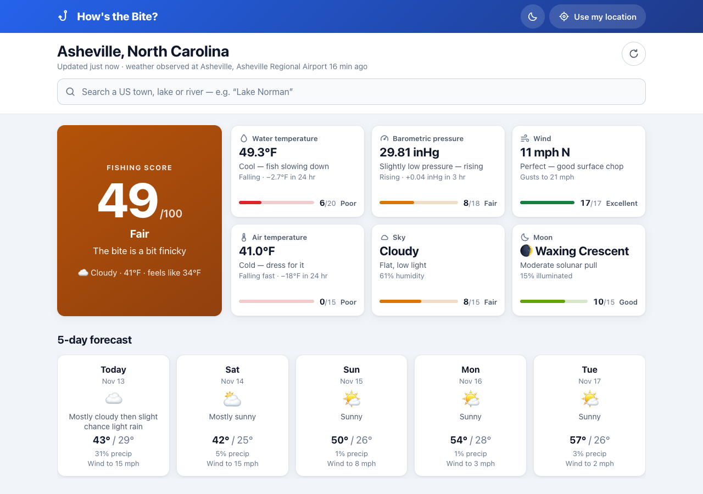

# 🎣 How's the Bite?

A Progressive Web App that answers one question for anglers: **how good is the fishing right now?**
Pick any US town, lake or river and get a 0–100 score built from live weather, barometric
pressure trends, moon phase and real water temperature from the nearest USGS sensor, plus the
current river level, flow or lake elevation.

No framework and nothing to compile: plain HTML, CSS and ES modules. The app itself needs
**no API keys**.



## Features

- **Fishing score (0–100)** with a per-factor breakdown that shows exactly where the points came from
- **Live water temperature** from nearby USGS monitoring stations; pick a different station from the
  list or the map, or filter to lakes or rivers. When no sensor is nearby the app falls back to a
  clearly labelled estimate
- **Water level and flow** from the nearest USGS gauge: river gage height and discharge, or lake
  and reservoir surface elevation, with the 24-hour change
- **Current conditions** observed at the nearest weather station: air temperature, pressure with
  its 3-hour trend, wind and gusts, sky
- **5-day forecast** with highs/lows, precipitation chance and wind
- **48-hour charts** for pressure, air temperature, water temperature and water level, with
  hover/touch/keyboard read-outs and a data table for each
- **Place search** for towns ("Asheville, NC") and for lakes, reservoirs and rivers by name
  ("Lake Norman", "French Broad River"), recent places, and optional "use my location"
- **Installable and offline-capable**: the app shell is cached by a service worker and the last
  loaded conditions are shown (with their real timestamp) when you have no signal
- Light and dark themes, responsive from phone to desktop, keyboard and screen-reader friendly

## Run it locally

```bash
npm install
npm start           # plain static server at http://localhost:8000
```

Any static server works (`python3 -m http.server 8000`, VS Code Live Server, …). The page has to be
served over `http://localhost` or HTTPS; opening `index.html` from disk will not work because
browsers block ES modules and service workers on `file://`.

To run it the way it runs in production, with the security headers and the USGS proxy:

```bash
npm run preview     # builds dist/ and serves it with Cloudflare's local runtime at http://localhost:8788
```

The proxy reads its USGS key from a git-ignored `.dev.vars` file in the project root:

```
USGS_API_KEY=your-key-here
```

Without that file the preview still works; the proxy just calls USGS anonymously.

## Tests

```bash
npm test            # unit tests: scoring, trends, moon phase, sky, helpers, the USGS proxy
npm run test:e2e    # browser tests (Playwright): the whole app, desktop and phone layouts
npm run test:all    # both
```

The browser tests need a browser once: `npx playwright install chromium`, or reuse one you already
have with `PLAYWRIGHT_CHANNEL=chrome npm run test:e2e`.

They never call the real services. Every external request is answered from fixtures in
`e2e/support/api-mocks.js` and the clock is pinned, so runs are repeatable, fast (about 15 seconds)
and spend none of the USGS rate limit. A test fails if the page makes a request that has no mock,
throws an uncaught error, or violates the Content-Security-Policy.

To run the same tests against the production-style preview (this is what checks the policy in
`_headers`): start `npm run preview`, then `E2E_BASE_URL=http://localhost:8788 npm run test:e2e`.

## Deploying to Cloudflare Pages

The site is static files plus one small server function, which fits Cloudflare Pages' free plan.
`wrangler.toml` holds the configuration, `npm run build` assembles `dist/`, and anything under
`functions/` is deployed as a Pages Function automatically.

One-time setup:

1. **Log in**: `npx wrangler login` (opens a browser).
2. **Create the project and publish**: `npm run deploy`. The first run offers to create a Pages
   project named `howsthebite` (change `name` in `wrangler.toml` if you prefer another); accept the
   default production branch. You get a `https://<project>.pages.dev` address.
3. **Give the proxy its key**: `npx wrangler pages secret put USGS_API_KEY`, paste the key
   (free at <https://api.waterdata.usgs.gov/signup>), then run `npm run deploy` once more so the
   function picks it up.
4. **Custom domain** (optional): Cloudflare dashboard → Workers & Pages → your project → Custom
   domains → add the domain. If the domain is registered or hosted at Cloudflare the DNS record is
   created for you.

After that, `npm run deploy` publishes a new version.

**Deploy on every push instead** (optional): in the Cloudflare dashboard choose Workers & Pages →
Create → Pages → Connect to Git, pick the repository, and set *Build command* `npm run build` and
*Build output directory* `dist`. Add `USGS_API_KEY` under Settings → Variables and Secrets. Each
push to the production branch then deploys, and other branches get preview URLs.

Checking a deployment:

```bash
curl -sI https://<your-site>/ | grep -i content-security-policy          # headers are applied
curl -s -o /dev/null -D - "https://<your-site>/api/usgs/monitoring-locations/items?id=USGS-05536137" | grep -i x-cache
```

The second command should print `x-cache: miss` the first time and `x-cache: hit` when repeated.

Other static hosts (GitHub Pages, Netlify, S3, …) work too: publish `dist/`. Without the Pages
Function there is no proxy, which the app detects on its first request, and it then talks to USGS
directly. `_headers` is a Cloudflare/Netlify convention; elsewhere set the same headers in that
host's own way.

When you add, rename or remove a file the page loads, update `SHELL` and bump `CACHE` in `sw.js`.
The build fails if `SHELL` lists a file that is not published, and a browser test fails if the
page loads a file that `SHELL` does not list.

### The USGS proxy

`functions/api/usgs/[[path]].js` answers `GET /api/usgs/<collection>/items` by calling USGS:

- **The key stays on the server.** Browsers never see it. Without the proxy every visitor has their
  own anonymous allowance (1,000 requests per hour per IP), which is fine for one person but not
  when many visitors share an address, and a key shipped in the page would be public.
- **Answers are cached at Cloudflare's edge**: readings for 10 minutes, station names for a day.
  The app snaps its search area to a 0.1° grid (about 7 miles), so people near each other ask
  the identical question and share one upstream request.
- **Outages are absorbed.** If USGS rate-limits or fails, the last good answer (up to six hours
  old) is served instead. Each reading carries its own timestamp, which the app shows.
- **It is not an open proxy.** Only the three collections and the query parameters the app uses are
  forwarded, only for GET, and the result limit is capped.

The `x-cache` response header reports `hit`, `miss` or `stale`.

## How the score works

Six factors add up to 100 points. The logic lives in `js/core/scoring.js` and is covered by
`tests/scoring.test.js`.

| Factor | Points | Best | How it is scored |
|---|---|---|---|
| Water temperature | 20 | 65–75°F | Bands: 58–78°F very good, 50–85°F good, 45–90°F fair. Measured readings get a small bonus when steady over 24 h (or warming when cold / cooling when hot) and a penalty for rapid swings. Estimates get no trend bonus. |
| Barometric pressure | 18 | 30.00–30.20 inHg, slowly falling | Up to 10 for the level plus up to 8 for the 3-hour trend: slowly falling 8, falling fast 6, steady 5, slowly rising 2, rising fast 0. If no barometer is in reach the factor scores a neutral 9. |
| Wind | 17 | 8–12 mph | A light chop is ideal; dead calm and anything over 25 mph score 0. |
| Air temperature | 15 | 65–75°F | Comfort bands, nudged by the 24-hour trend. |
| Sky | 15 | Clear | Clear 15, partly cloudy 12, mostly cloudy/overcast/fog 8, light precipitation 4, steady rain or snow 2, thunderstorms 0. |
| Moon phase | 15 | New or full moon | 15 at new/full, falling to 5 at the quarters. |

Overall rating: 85+ exceptional, 70+ excellent, 55+ good, 40+ fair, 25+ poor, 10+ very poor.

The weights and bands are rules of thumb, not science. They are easy to tune in one file.

## Data sources

| Data | Source | Notes |
|---|---|---|
| Current weather, 72-hour history, forecast, place names for "use my location" | [US National Weather Service API](https://www.weather.gov/documentation/services-web-api) | Public domain, no key, US and territories only |
| Town, lake and river search | [Photon](https://photon.komoot.io/) (OpenStreetMap data, hosted by komoot) | Free community service with a fair-use policy and no uptime guarantee |
| Water temperature, level, flow | [USGS Water Data APIs](https://api.waterdata.usgs.gov/docs/ogcapi/) | Public domain. `latest-continuous`, `monitoring-locations` and `continuous` collections. Readings are provisional. |
| Map tiles | [OpenStreetMap](https://www.openstreetmap.org/copyright) via [Leaflet](https://leafletjs.com/) (vendored in `vendor/leaflet`) | Loaded only when the map scrolls into view |

### Where the weather readings come from

Current conditions are real observations, not a model: temperature and wind come from the nearest
station that reports both, and the page says which station and how old the reading is. Many rural
stations (roadside and fire-weather sensors) have no barometer or sky sensor. Pressure changes
slowly over distance, so it is then taken from the nearest airport station, which is also named
on the page; sky conditions fall back to the NWS forecast for that spot.

### About "depth"

There is no nationwide public feed of how deep a lake or river is. What USGS publishes, and what the
app shows, is the water *level*:

- **Gage height** (rivers): the height of the surface above that gauge's own fixed reference point.
  It is not the depth of the channel, so the trend (rising, falling, steady) is the useful part.
- **Discharge** (rivers): flow in cubic feet per second.
- **Elevation** (lakes and reservoirs): the height of the surface above a sea-level datum. Comparing
  it with the lake's normal or "full pool" elevation tells you how full it is.

Bathymetry (depth maps) exists only in scattered state and federal datasets, with no common API.

### Licences, if the site ever earns money

- **NWS** and **USGS** data are public domain: no restriction on commercial use.
- **Photon** and the **OpenStreetMap tile servers** are donated community services with fair-use
  policies and no guarantee. They do not forbid commercial sites, but a site with real traffic
  should move to a paid tile/geocoding provider or self-host. OpenStreetMap data requires the
  attribution shown in the page footer.

### Privacy

There is no analytics. Your saved places and the last loaded conditions stay in your browser's
local storage. To fetch conditions, coordinates rounded to about 100 m go to the National Weather
Service; USGS (or this site's proxy in front of it) is only asked about a box roughly 130 miles
across, snapped to a 7-mile grid. The text you type in the search box goes to Photon. Your
location is requested only when you press "Use my location".

## Project structure

```
index.html              Page markup and the SVG icon sprite
404.html                Not-found page
styles.css              All styles (CSS custom properties for the light/dark themes)
sw.js                   Service worker: caches the app shell for offline use
manifest.json           PWA manifest
_headers                Security headers (Content-Security-Policy etc.) for Cloudflare Pages
wrangler.toml           Cloudflare Pages configuration
js/
  app.js                Entry point: state, rendering, event wiring
  theme-init.js         Applies the saved theme before first paint
  config.js             Endpoints, tunables, rating bands, phrases
  storage.js            Guarded localStorage access (places, theme, last snapshot)
  api/
    http.js             fetch + JSON with timeout and cancellation
    weather-api.js      NWS observations and forecast, Photon place search
    usgs-api.js         USGS stations: water temperature, level, flow and their history
  core/                 Pure logic with no DOM access (unit tested)
    scoring.js          The fishing score
    trend.js            Time-based trend analysis
    moon.js             Moon phase
    sky.js              NWS sky reports -> label, emoji, sky class
    util.js             Distance, formatting and other helpers
  ui/
    charts.js           SVG line chart with tooltip, keyboard support and data table
    map.js              Lazy-loaded Leaflet station map
    theme.js            Light/dark toggle
    dom.js              Tiny DOM-building helpers
functions/
  api/usgs/[[path]].js  Cloudflare Pages Function: caching proxy for the USGS API
scripts/build.mjs       Copies the publishable files to dist/
tests/                  Unit tests (node --test)
e2e/                    Browser tests (Playwright)
  support/api-mocks.js  Fixture responses for every external service
  support/fixtures.js   Shared test setup: mocked network, pinned clock, helpers
playwright.config.js
vendor/leaflet/         Leaflet 1.9.4 (BSD-2-Clause)
```

## Browser support

Current versions of Chrome, Edge, Firefox and Safari (desktop and mobile). The app uses ES modules,
CSS `color-mix()` and `:has()`, `ResizeObserver` and `IntersectionObserver`.

## Troubleshooting

- **"Couldn't load the weather"**: check your connection and press *Try again*. If you have opened
  the app before, the last loaded conditions stay on screen with their age.
- **"…has no data for this spot"**: the National Weather Service covers the United States and its
  territories only.
- **Water temperature shows "≈" and "estimated"**: no USGS sensor has reported within 60 miles in
  the last 24 hours (or USGS is unreachable). Try a larger town nearby, or switch the filter to *All*.
- **"USGS is rate-limiting requests"**: without the proxy, USGS allows 1,000 requests an hour per
  IP address. Wait for the hour to roll over, or run through the proxy (`npm run preview`, or the
  deployed site) with a key.
- **"Use my location" does nothing useful**: the browser blocked location access. Allow it in the
  site settings, or search for a place instead.
- **Something works locally but not when deployed**: open the browser console and look for a
  Content-Security-Policy message. A new data source has to be added to `connect-src` in `_headers`.
- **Changes not showing up while developing**: the service worker fetches app files network-first,
  so a normal reload is enough. If in doubt, unregister it under DevTools → Application.

## License

MIT. Leaflet is © Volodymyr Agafonkin and contributors, BSD-2-Clause (see `vendor/leaflet/LICENSE`).
